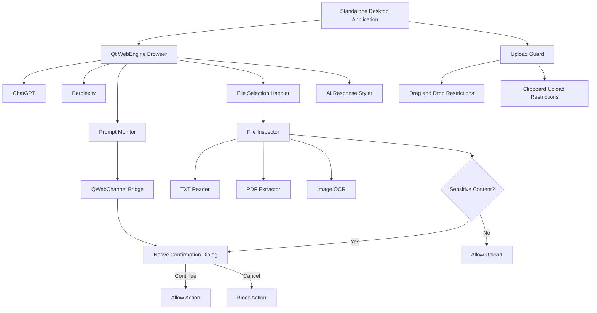

# Sensitive Upload Guard

A standalone Windows desktop application that provides
client-side Data Loss Prevention (DLP) controls for
ChatGPT and Perplexity.

The application detects sensitive content in text prompts
and file uploads, requests user confirmation before
allowing detected sensitive content, and customizes the
color of AI-generated responses.

## Supported Platforms

- ChatGPT — https://chatgpt.com
- Perplexity — https://www.perplexity.ai

## Features

- Standalone desktop application with an embedded browser.
- No browser extensions, plugins or add-ons required.
- Sensitive text prompt detection.
- TXT file inspection.
- PDF text extraction and OCR inspection.
- Image inspection using Tesseract OCR.
- Native Windows confirmation dialogs.
- Continue and Cancel options for sensitive content.
- Safe content allowed without confirmation.
- Drag-and-drop file upload restrictions.
- Clipboard file and image upload restrictions.
- AI-generated responses displayed in green.
- Separate browser tabs for ChatGPT and Perplexity.

## Sensitive Content Detection

The application detects the following case-sensitive marker:

`WALLED_SENSITIVE`

When sensitive content is detected, a native confirmation
dialog is displayed.

- Continue: Allows the original prompt or selected file.
- Cancel: Blocks the current submission or file selection.

Files that cannot be inspected are blocked.

## Technology Stack

| Technology | Purpose |
|---|---|
| Python | Application development |
| PySide6 | Desktop GUI |
| Qt WebEngine | Embedded Chromium browser |
| QWebChannel | JavaScript-Python communication |
| JavaScript | Prompt interception and response styling |
| PyMuPDF | PDF text extraction |
| Tesseract OCR | Image text recognition |
| Pillow | Image processing |
| Git | Version control |

## Architecture



## Project Structure

```text
SensitiveUploadGuardDesktop/
├── main.py
├── approval_bridge.py
├── file_inspector.py
├── response_styler.py
├── upload_guard.py
├── generate_test_images.py
├── generate_test_pdfs.py
├── test_dialog.py
├── test_inspector.py
├── requirements.txt
├── .gitignore
└── README.md
```

### Component Responsibilities

- `main.py`: Initializes the desktop application, browser
  tabs, prompt monitor and file selection handler.

- `approval_bridge.py`: Connects JavaScript prompt
  interception with native confirmation dialogs.

- `file_inspector.py`: Inspects TXT, PDF and image files
  for sensitive content.

- `response_styler.py`: Changes AI-generated response
  text color using DOM selectors and MutationObserver.

- `upload_guard.py`: Restricts common drag-and-drop
  and clipboard upload paths.

## Prerequisites

- Windows 10 or Windows 11
- Python 3.13 (development environment)
- Tesseract OCR
- Internet connection

## Installation

### 1. Clone the repository

```powershell
git clone <repository-url>
cd SensitiveUploadGuardDesktop
```

### 2. Create a virtual environment

```powershell
python -m venv .venv
```

### 3. Activate the virtual environment

```powershell
.\.venv\Scripts\Activate.ps1
```

### 4. Install Python dependencies

```powershell
python -m pip install -r requirements.txt
```

### 5. Install Tesseract OCR

```powershell
winget install --id UB-Mannheim.TesseractOCR -e
```

The application searches for Tesseract in the system
PATH and falls back to the default Windows installation
location:

```text
C:\Program Files\Tesseract-OCR\tesseract.exe
```

## Running the Application

```powershell
python main.py
```

The application opens a desktop window containing
ChatGPT and Perplexity browser tabs.

## How It Works

### Text Prompt Inspection

1. The user enters a prompt.
2. JavaScript intercepts supported submission events.
3. The prompt is checked for the sensitive marker.
4. Sensitive submissions are temporarily blocked.
5. QWebChannel invokes a native confirmation dialog.
6. Continue resumes the submission.
7. Cancel prevents the intercepted submission.

### File Upload Inspection

1. The user selects a file using the attachment button.
2. Qt WebEngine intercepts file selection.
3. The file inspector processes the selected file locally.
4. Sensitive files require explicit user confirmation.
5. Approved and safe files are returned to the browser.
6. Cancelled or uninspectable files are excluded.

### Response Color Customization

JavaScript identifies AI-generated response elements
and applies a green text color (#22c55e).

A MutationObserver handles dynamically generated
response content.

### Upload Bypass Mitigation

Common file drag-and-drop and clipboard image/file
paste operations are restricted.

Users are directed to use the attachment button,
which passes selected files through the inspection
pipeline.

## Testing

Use synthetic test content only.

### Text Prompt Examples

Safe prompt:

```text
Explain JavaScript in three sentences.
```

Sensitive prompt:

```text
This is a WALLED_SENSITIVE test message.
```

### File Upload Testing

Create safe and sensitive TXT files inside a local
`tests` directory.

Generate PDF and image fixtures:

```powershell
python generate_test_pdfs.py
python generate_test_images.py
```

Generated test files are excluded from version control.

### Expected Behavior

| Test Scenario | Expected Result |
|---|---|
| Safe text prompt | Allowed |
| Sensitive text prompt | Confirmation dialog |
| Safe TXT file | Allowed |
| Sensitive TXT file | Confirmation dialog |
| Safe PDF file | Allowed |
| Sensitive PDF file | Confirmation dialog |
| Safe image | Allowed |
| Sensitive image | Confirmation dialog |
| Continue | Original action allowed |
| Cancel | Current action blocked |
| Retry after cancellation | Allowed to retry |
| File drag-and-drop | Restricted |
| Clipboard image upload | Restricted |
| Normal text paste | Allowed |
| AI-generated response | Green text |

Repeat these tests on both supported platforms.

## Security and Privacy

- File inspection is performed locally.
- No external OCR service is required.
- Sensitive content requires user confirmation through
  supported interception paths.
- Browser session data and generated test files are
  excluded from version control.

## Known Limitations

- This is a proof-of-concept desktop DLP application,
  not an enterprise-grade security product.
- Protection applies within the embedded browser,
  not external browsers or other applications.
- Prompt interception and response styling depend on
  website DOM structures and supported browser events.
- Website updates may require selector changes.
- OCR accuracy depends on image quality and readability.
- Direct file drag-and-drop and clipboard image uploads
  are restricted rather than individually inspected.
- Unsupported or uninspectable file types are blocked.
- Network-level interception and comprehensive bypass
  resistance are outside the current implementation.

## Future Enhancements

- Network-level request inspection.
- Configurable sensitive content detection rules.
- Additional file format support.
- Improved OCR accuracy.
- Automated regression testing.
- Security event auditing.
- Windows executable packaging.


